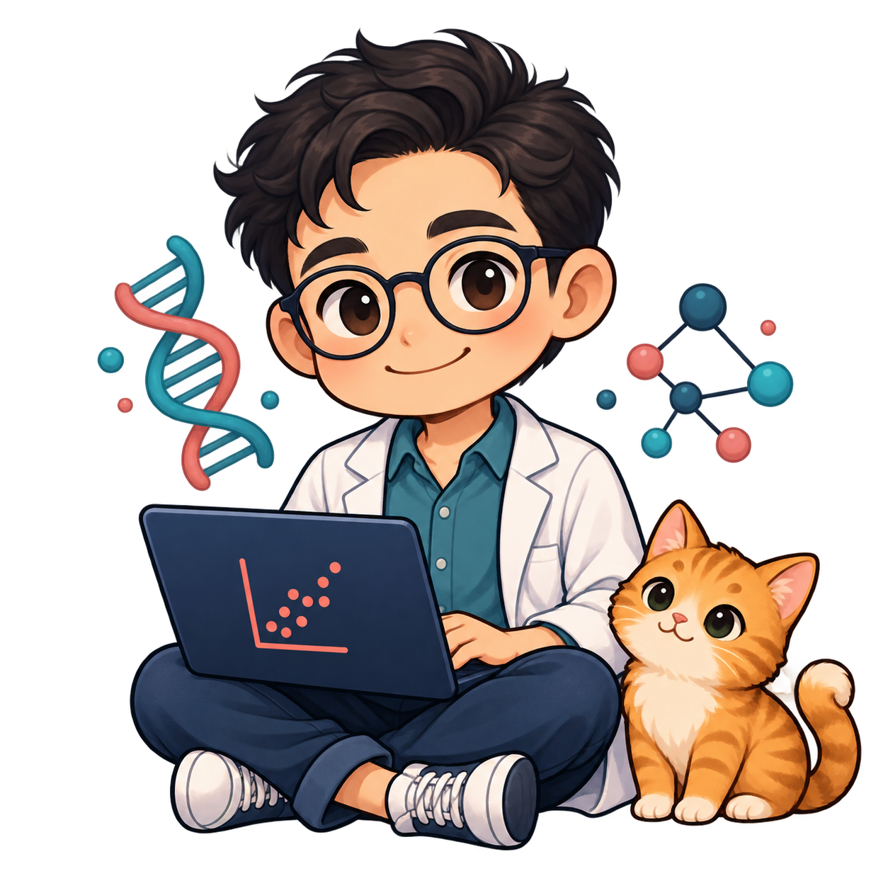

### Hi, I’m Andrew 👋

I’m a biomedical scientist turned data scientist in Melbourne,
connecting biology, statistics, data engineering and software to help scientists
make sense of their data.

🧪 **Building**: Biomedical analytics, scientific workflows, data pipelines
and AI agents for research.

🛠️ **Tech stack**: Python, R, SQL, Microsoft Fabric, Azure, ImageJ

📊 **Modelling**: Mixed-effects models, Machine learning, LLMs

🌱 **Exploring**: Computational biology/chemistry and image analysis

🔭 **Outside work**: Astrophotography, hiking and adventures
with our ginger cat, Mochi.

